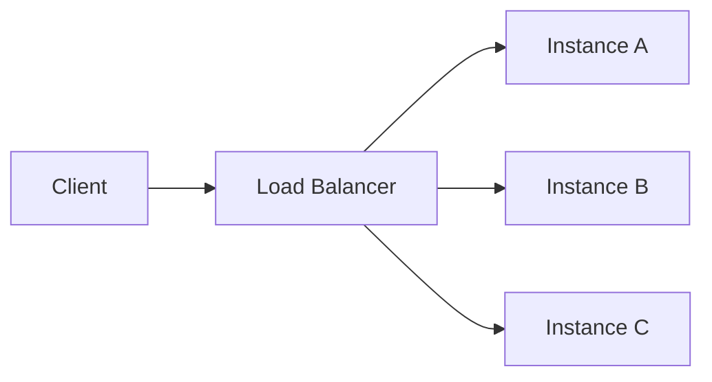

# Animating a diagram

A ```mermaid fence in your reply is drawn as a real diagram. Give it a `flow:` script and it
moves: a packet travels the route you name, nodes change state, and they get a timeline they can
stop and scrub.

This exists because some explanations are about *order*, and an arrow does not carry order. A
request moving through four services. A failover. A retry. Those are flow scripts. Most things
are not.

## Decide whether it moves at all

In order of preference — the first one that fits wins:

1. **Prose.** Most answers. If it fits in three sentences it is three sentences.
2. **A still ```mermaid diagram.** A shape that holds still: a flow, a sequence, a dependency
   graph.
3. **A ```mermaid diagram with a flow script.** The same diagram, plus the order things happen
   in. Six extra lines on a diagram you were going to draw anyway.

A screen — what something should *look like* — is none of these. That is a design file on the
canvas: read `designing-a-screen`. An ```html fence in a reply is shown as source, not run.

## A diagram that moves

Put a `flow:` block in the diagram's YAML frontmatter and the fence renders as an animated
diagram — a packet travels the route you name, nodes change state, everything off the route dims,
and the reply gets a timeline they can pause and scrub. Without the block the same fence is an
ordinary still diagram, so this is an addition to mermaid, not a second language.



The steps: `route` (two or more nodes, optional `color` and `dur` in ms), `wait` (ms), `state`
(a node to `error`, `ok` or `busy` — persists until changed), `parallel` (children at once), and
`repeat` (a count plus its own `steps`). `speed` is packet pixels per second, default 220.

**`steps:` plays once and holds its last frame. Write that unless the repetition is the point.**
`loop:` in its place runs it round and round, which is right for a poll, a heartbeat, or a queue
that never empties, and wrong for everything else: an explanation on its fourth pass is not
explaining any more, it is a thing moving beside the paragraph they are trying to read. Either
way they get stop, play-again and a scrubber, and the diagram does not start until it is on
their screen.

Three things it will refuse, each of which loses the animation and leaves the still diagram with
the error printed under it:

- **A node it cannot find.** Name nodes by their mermaid id — `A`, not `Instance A`.
- **A hop with no edge under it.** Every consecutive pair in a route must be a real arrow in the
  diagram. A route may run *backwards* along one, which is how you show a response.
- **Tabs.** Two spaces per level, as YAML.

Names are the forgiving part, so do not agonise over them. Colours are `amber`, `yellow`, `red`,
`green`, `cyan`, `blue`, `purple`, `pink` or a quoted hex — `"#ff0088"`, because an unquoted `#`
starts a YAML comment — and a node's state is `error`, `ok` or `busy`. The ordinary synonym for
any of those is accepted as the same thing (`orange`, `teal`, `violet`, `failed`, `healthy`,
`warning`, and so on), and a name nobody has ever heard of is drawn in the default colour, or as
`busy`, with a line under the diagram saying so. It costs you the shade, never the animation.

Sequence diagrams work as well as flowcharts. Keep the choreography to the handful of steps that
carry the point: a script with thirty steps is a video nobody will watch to the end, and the
diagram underneath it was doing most of the work anyway.
